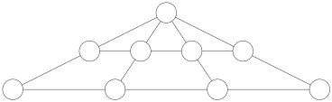

Wir betrachten die folgende Figur:

Wir suchen Beschriftungen der neun Felder in der Figur mit den Zahlen $1, 2, \ldots, 9$. Dabei soll jede dieser Zahlen genau einmal verwendet werden. Weiters sollen die sechs Summen von jeweils drei bzw. vier Zahlen längs der eingezeichneten geraden Verbindungen gleich sein.

Man gebe eine solche Beschriftung an.

Man zeige, dass bei allen solchen Beschriftungen im obersten Feld die selbe Zahl steht.

Wie viele solche Beschriftungen gibt es insgesamt? (Zwei Beschriftungen sind verschieden, wenn sie sich in mindestens einem Feld unterscheiden.)

(Walther Janous)
