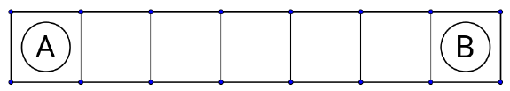

Alice und Bob spielen ein Spiel auf einem Streifen aus $n \geq 3$ Quadraten mit zwei Spielsteinen. Zu Beginn befindet sich der Stein von Alice auf dem ersten Feld und der Stein von Bob auf dem letzten Feld. Die Abbildung zeigt die Ausgangsstellung für einen Streifen von $n = 7$ Quadraten.

Gezogen wird abwechselnd. Ein Zug besteht darin, den eigenen Stein um ein oder um zwei Felder in Richtung des gegnerischen Steins auf ein leeres Feld zu versetzen, ohne den gegnerischen Stein zu überspringen. Alice macht mit ihrem Stein den ersten Zug. Verloren hat, wer keinen Zug mehr machen kann.

Für welche $n$ kann Bob sicher gewinnen, egal wie Alice spielt? Für welche $n$ kann Alice sicher gewinnen, egal wie Bob spielt?

(Karl Czakler)
