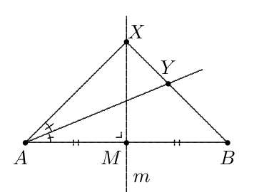

Beschouw een lijnstuk $[AB]$ met midden $M$ en middelloodlijn $m$. Voor elk punt $X \neq M$ op $m$ beschouwen we het snijpunt $Y$ van de rechte $BX$ met de bissectrice van de hoek $\widehat{BAX}$. Als $X$ tot $M$ nadert, dan nadert $Y$ tot een punt van $[AB]$. Welk?

