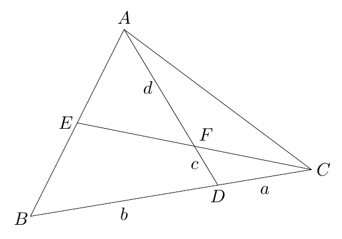

Gegeven is een driehoek $ABC$ en punten $D$ en $E$, respectievelijk op $]BC[$ en $]AB[$. $F$ is het snijpunt van de rechten $AD$ en $CE$. We stellen $|CD| = a$, $|BD| = b$, $|DF| = c$ en $|AF| = d$. Bepaal de verhouding $\dfrac{|BE|}{|AE|}$ in functie van $a$, $b$, $c$ en $d$.

