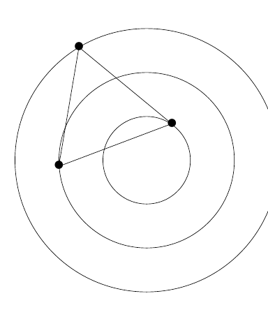

Beschouw (in het vlak) drie concentrische cirkels met stralen 1, 2 en 3 en gelijkzijdige driehoek $\Delta$ zodanig dat op elk van de drie cirkels één hoekpunt van $\Delta$ ligt. Bereken de lengte van de zijden van $\Delta$.

