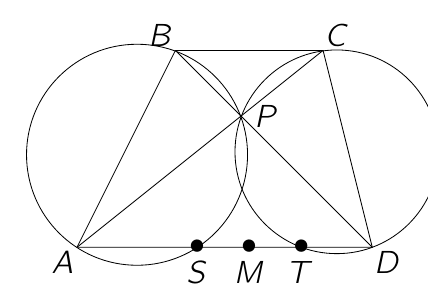

In de vierhoek $ABCD$ is $AD \parallel BC$ en zijn de hoeken $\widehat{A}$ en $\widehat{D}$ scherpe hoeken. De diagonalen snijden elkaar in $P$. De omgeschreven cirkels van $\triangle ABP$ en $\triangle CDP$ snijden de rechte $AD$ opnieuw in $S$ en $T$ respectievelijk. Noem $M$ het midden van $[ST]$. Bewijs dat $\triangle BCM$ gelijkbenig is.

