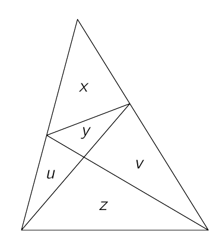

Drie lijnstukken verdelen een driehoek in vijf driehoeken. De oppervlakte van deze driehoeken noemen we $u$, $v$, $x$, $y$ en $z$, zoals in de figuur.

(a) Bewijs dat $uv = yz$.

(b) Bewijs dat de oppervlakte van de grote driehoek gelijk is aan $\dfrac{xz}{y}$.

