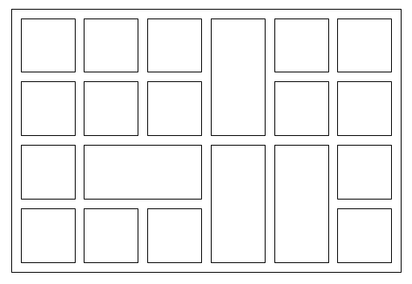

In een afgesloten rechthoekige wijk zijn er

- $S$ straten (dit zijn rechte wegen van maximale lengte),
- $V$ vierarmenkruispunten (┼),
- $H$ huizenblokken (dit zijn rechthoekige gebieden begrensd door vier straten, die niet door een andere straat worden gesneden) en
- $T$ stelt het aantal T-kruispunten (┬) voor.

Bijvoorbeeld, in de onderstaande wijk zijn er 15 straten, 8 vierarmenkruispunten, 20 huizenblokken en 22 T-kruispunten.

Bewijs dat in elke wijk $S + V = H + 3$.
