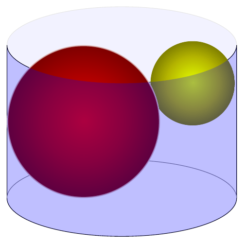

In een cilindervormig blik met diameter $d$ zitten twee elkaar rakende ballen opgesloten met stralen $a$ en $b$. Beide ballen raken het bovenvlak en de mantel van de cilinder. De grootste bal raakt ook het ondervlak. Toon aan dat $\sqrt{d} = \sqrt{a} + \sqrt{b}$.

