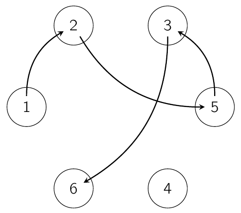

Er liggen $n$ hoepels op een cirkel. Rik nummert alle hoepels met een natuurlijk getal zodat alle getallen van 1 tot en met $n$ precies één keer voorkomen. Daarna maakt hij een wandeling van hoepel naar hoepel. Hij start in hoepel 1 en volgt dan de volgende regel: als hij in hoepel $k$ komt, dan wandelt hij naar de hoepel die in wijzerzin $k$ plaatsen verder ligt, zonder in de tussenliggende hoepels te komen.

De wandeling eindigt wanneer Rik naar een hoepel moet wandelen waar hij al geweest is. De lengte van de wandeling is het aantal hoepels dat hij aangedaan heeft onderweg.

Voor $n = 6$ kan Rik bijvoorbeeld een wandeling van lengte 5 maken als de hoepels genummerd zijn zoals op de figuur.

(a) Bepaal voor elke even $n$ hoe Rik de hoepels kan nummeren zodanig dat hij een wandeling van lengte $n$ kan maken.

(b) Bepaal voor elke oneven $n$ hoe Rik de hoepels kan nummeren zodanig dat hij een wandeling van lengte $n-1$ kan maken.

(c) Toon aan dat er voor een oneven $n$ geen nummering van de hoepels bestaat zodanig dat Rik een wandeling van lengte $n$ kan maken.
