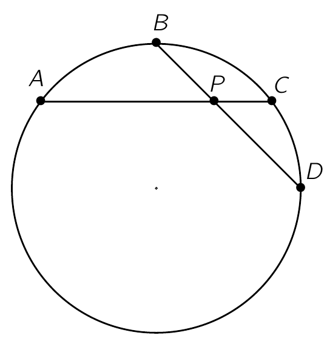

De punten $A, B, C, D$ liggen in die volgorde op een cirkel. De rechten $AC$ en $BD$ snijden in het punt $P$. Het punt $B'$ ligt op de rechte $AB$ zodat $A$ tussen $B$ en $B'$ ligt en $|AB'| = |DP|$. Het punt $C'$ ligt op de rechte $CD$ zodat $D$ tussen $C$ en $C'$ ligt en $|DC'| = |AP|$. Bewijs dat $\widehat{B'PC'} = \widehat{ABD}$.

