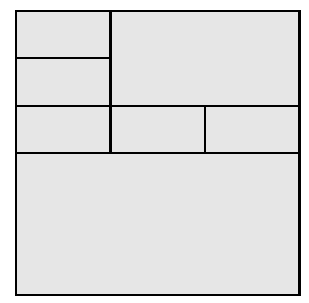

Een domino is een rechthoek waarvan de lengte het dubbele is van de breedte. Elk vierkant kan onderverdeeld worden in zeven domino's, bijvoorbeeld zoals op de onderstaande figuur.

a) Toon aan dat je een vierkant kan onderverdelen in $n$ domino's voor alle $n \geqslant 5$.

b) Toon aan dat je een vierkant *niet* kan onderverdelen in drie of in vier domino's.
