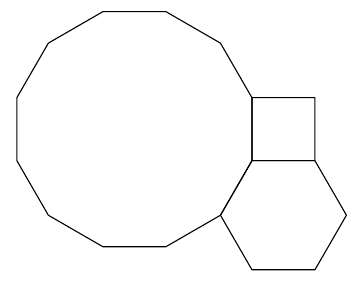

De hoekpunten van een regelmatige 4-hoek, 6-hoek en 12-hoek kunnen in een punt samengebracht worden om samen een volledige hoek van $360^\circ$ te vormen (zie figuur).

Bepaal alle drietallen $a, b, c \in \mathbb{N}$ met $a < b < c$ waarvoor de hoeken van een regelmatige $a$-hoek, $b$-hoek en $c$-hoek samen ook $360^\circ$ vormen.
