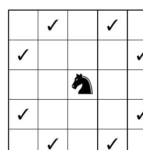
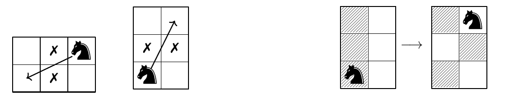

Ron heeft een magisch spelbord met uitsluitend witte velden. Hij wil een schaakbordpatroon maken met witte en zwarte velden, waarbij geen twee gelijk gekleurde velden naast elkaar liggen.

Ron beschikt bovendien over één schaakstuk: een paard. Ron zet het paard op een veld naar keuze. Hij verzet het daarna telkens met een paardensprong naar een ander veld, dat ofwel twee velden horizontaal en één verticaal, ofwel twee velden verticaal en één horizontaal verder ligt, zoals in de figuur hiernaast.

In vogelvlucht springt het paard zo over twee velden, aangeduid met een kruisje in de figuur hieronder. Bij elke paardensprong veranderen die twee velden allebei van kleur: zwart wordt wit en wit wordt zwart, zoals in het voorbeeld ernaast.

a. Toon aan dat Ron *wel* een schaakbordpatroon kan maken als het spelbord 3 bij 3 velden groot is.

b. Toon aan dat Ron *geen* schaakbordpatroon kan maken als het spelbord 4 bij 4 velden groot is.

c. Toon aan dat Ron *geen* schaakbordpatroon kan maken als het spelbord 3 bij 5 velden groot is.
