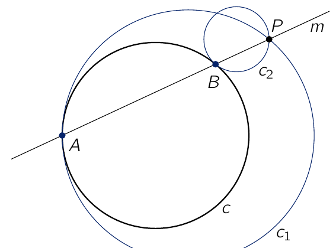

Een punt $P$ ligt buiten een cirkel $c$ zoals in de figuur. Een rechte $m$ door $P$ snijdt de cirkel $c$ in twee verschillende punten $A$ en $B$.

De cirkel $c_1$ gaat door het punt $P$ en raakt aan de cirkel $c$ in het punt $A$. De cirkel $c_2$ gaat door het punt $P$ en raakt aan de cirkel $c$ in het punt $B$.

Toon aan dat het verschil tussen de stralen van de cirkels $c_1$ en $c_2$ niet afhangt van de ligging van het punt $P$ en ook niet van de gekozen snijlijn $m$.
