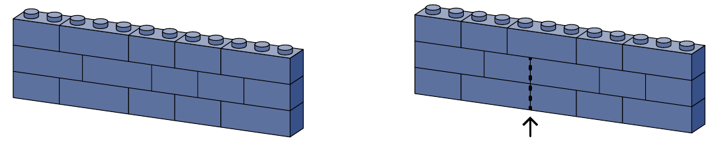

Bob heeft twee soorten LEGO®-stenen: stenen met 1 bij 2 noppen en stenen met 1 bij 3 noppen. Hij bouwt muren zonder gaten, met rechte zijkanten en met een diepte van 1 nop. Zo'n muur noemen we *stevig* als er nooit twee uiteinden van stenen boven elkaar staan, behalve aan de zijkanten van de muur. Zo is de muur in de figuur links stevig, maar die in de figuur rechts niet.

Vandaag bouwt Bob enkel stevige muren waarbij elke rij 12 noppen heeft.

(a) Bob bouwt eerst een muur van vier rijen hoog. Een van de rijen bestaat uitsluitend uit stenen van 2 noppen breed. Toon aan dat die muur nog zo'n rij bevat.

(b) Bob bouwt nog een muur van vier rijen hoog. Nu bestaat een van de rijen uitsluitend uit stenen van 3 noppen breed. Toon aan dat die muur nog zo'n rij bevat.

(c) Ten slotte bouwt Bob een muur die geen twee gelijke rijen bevat. Hoeveel rijen kan die muur hoogstens bevatten?
