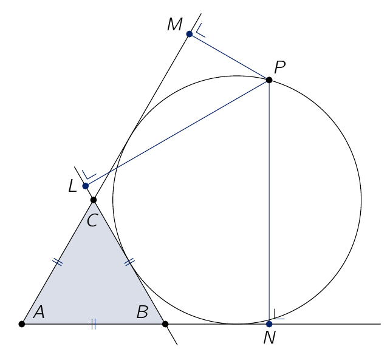

In de figuur zie je een gelijkzijdige driehoek $\triangle ABC$ en de cirkel met middelpunt buiten $\triangle ABC$ die raakt aan het lijnstuk $[BC]$ en aan de rechten $AB$ en $AC$. Punt $P$ ligt op de cirkel en de punten $L$, $M$ en $N$ zijn de loodrechte projecties van $P$ op respectievelijk de rechten $BC$, $AC$ en $AB$.

Bewijs dat $3|PL| \leqslant 2|PM| + 2|PN|$.

