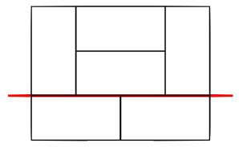

An $m \times n$ rectangle is tiled with $\frac{mn}{2}$ $1 \times 2$ dominoes. The tiling is such that whenever the rectangle is partitioned into two smaller rectangles, there exists a domino that is part of the interior of both rectangles. Given $mn > 2$, what is the minimum possible value of $mn$?

For instance, the following tiling of a $4 \times 3$ rectangle doesn't work because we can partition along the line shown, but that doesn't necessarily mean other $4 \times 3$ tilings don't work.

