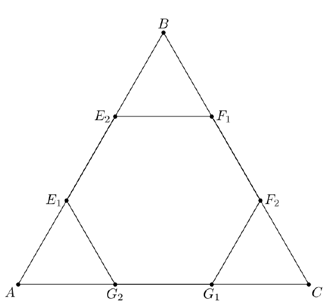

Let $\triangle ABC$ be an equilateral triangle with side length $M$ such that points $E_1$ and $E_2$ lie on side $AB$, $F_1$ and $F_2$ lie on side $BC$, and $G_1$ and $G_2$ lie on side AC, such that $m = \overline{AE_1} = \overline{BE_2} = \overline{BF_1} = \overline{CF_2} = \overline{CG_1} = \overline{AG_2}$ and the area of polygon $E_1E_2F_1F_2G_1G_2$ equals the combined areas of $\triangle AE_1G_2$, $\triangle BF_1E_2$, and $\triangle CG_1F_2$. Find the ratio $\frac{m}{M}$.

