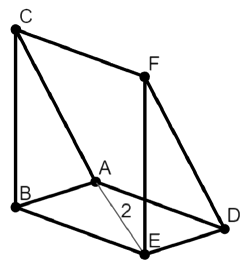

Right triangular prism $ABCDEF$ with triangular faces $\triangle ABC$ and $\triangle DEF$ and edges $\overline{AD}$, $\overline{BE}$, and $\overline{CF}$ has $\angle ABC = 90^\circ$ and $\angle EAB = \angle CAB = 60^\circ$. Given that $AE = 2$, the volume of $ABCDEF$ can be written in the form $\frac{m}{n}$, where $m$ and $n$ are relatively prime positive integers. Compute $m + n$.

