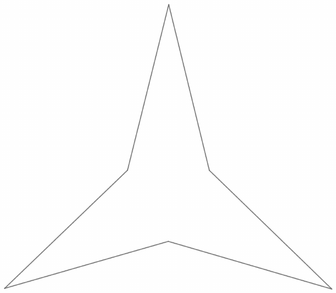

In the star shaped figure below, if all side lengths are equal to $3$ and the three largest angles of the figure are $210$ degrees, its area can be expressed as $\frac{a\sqrt{b}}{c}$, where $a$, $b$, and $c$ are positive integers such that $a$ and $c$ are relatively prime and that $b$ is square-free. Compute $a + b + c$.

