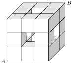

Consider $27$ unit-cubes assembled into one $3 \times 3 \times 3$ cube. Let $A$ and $B$ be two opposite corners of this large cube. Remove the one unit-cube not visible from the exterior, along with all six unit-cubes in the center of each face. Compute the minimum distance an ant has to walk along the surface of the modified cube to get from $A$ to $B$.

