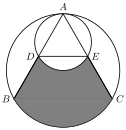

Let equilateral triangle $\triangle ABC$ be inscribed in a circle $\omega_1$ with radius $4$. Consider another circle $\omega_2$ with radius $2$ internally tangent to $\omega_1$ at $A$. Let $\omega_2$ intersect sides $\overline{AB}$ and $\overline{AC}$ at $D$ and $E$, respectively, as shown in the diagram. Compute the area of the shaded region.

