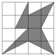

Big Chungus has been thinking of a new symbol for BMT, and the drawing below is what he came up with. If each of the $16$ small squares in the grid are unit squares, what is the area of the shaded region?

