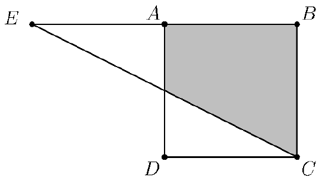

Given a square $ABCD$ of side length $6$, the point $E$ is drawn on the line $AB$ such that the distance $EA$ is less than $EB$ and the triangle $\triangle BCE$ has the same area as $ABCD$. Compute the shaded area.

