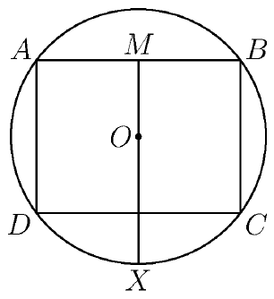

Let rectangle $ABCD$ have side lengths $AB = 8$, $BC = 6$. Let $ABCD$ be inscribed in a circle with center $O$, as shown in the diagram. Let $M$ be the midpoint of side $\overline{AB}$, and let $X$ be the intersection of ray $\overrightarrow{MO}$ with the circle. Compute the length $AX$.

