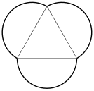

Andrew has three identical semicircular mooncake halves, each with radius $3$, and uses them to construct the following shape, which contains an equilateral triangle in the center. Compute the perimeter around this shape, in bold below.

