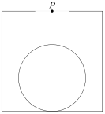

A square with side length $6$ has a circle with radius $2$ inside of it, with the centers of the square and circle vertically aligned. Aarush is standing $4$ units directly above the center of the circle, at point $P$. What is the area of the region inside the square that he can see? (Assume that Aarush can only see parts of the square along straight lines of sight from $P$ that are unblocked by any other objects.)

