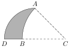

During his escape from Alcatraz Island, Aditya swims to San Francisco and sees a shark fin above the water, indicated by the shaded area in the diagram below. The shark fin is formed by a quarter circle of radius $3$ with arc $\overset{\frown}{AD}$ cut by its overlap with a $45^\circ$ sector of the circle centered at $C$ passing through $A$ and $B$ (on the two straight sides of the quarter circle). Compute the area of the shark fin.

