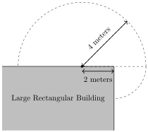

Stephanie uses a rope of length $4$ meters to tie a sheep to a point that is $2$ meters away from the corner of a large rectangular building. Given the sheep cannot enter the building, what is the area, in square meters, that the sheep can graze?

