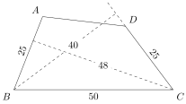

Quadrilateral $ABCD$ has $AB = CD = 25$, $BC = 50$, and acute angles at vertices $B$ and $C$. The distance from $C$ to line $\overleftrightarrow{AB}$ is $48$, and the distance from $B$ to line $\overleftrightarrow{CD}$ is $40$. Compute the area of quadrilateral $ABCD$.

