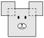

Ben the Bear's head is constructed using one square of side length $2$ and two squares of side length $1$, where all the squares have parallel sides, and the centers of the small squares are adjacent vertices of the large square. Find the perimeter around Ben's head.

