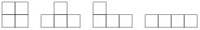

Určete největší přirozené číslo $n$ s vlastností: Libovolnou sadu $n$ tetramin, z nichž každé je jednoho ze čtyř tvarů na obrázku, lze bez překrývání umístit do tabulky $20 \times 20$ tak, že každé tetramino pokrývá právě čtyři pole tabulky. (Jednotlivá tetramina můžeme libovolně otáčet a překlápět.)

