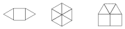

Gegeben sei ein hinreichend großer Vorrat von gleichseitigen Dreiecken und Quadraten, alle mit der gleichen Seitenlänge. Aus diesen Bausteinen lassen sich konvexe* Polygone bilden, indem man sie in der Ebene lückenlos und überschneidungsfrei aneinander legt. (Die Figur zeigt drei Möglichkeiten für ein Sechseck.)

a) Welches ist die größtmögliche Anzahl $m$ von Seitenkanten für ein so gebildetes konvexes Polygon? (Die Antwort ist zu begründen.)

b) Man gebe für alle möglichen Anzahlen von Seitenkanten $\le m$ jeweils ein Beispiel an.

*) Eine Figur heißt konvex, wenn für je zwei ihrer Punkte auch alle Punkte der Verbindungsstrecke zu der Figur gehören.
