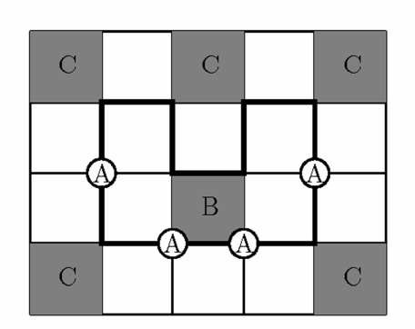

Es seien $m, n \ge 4$ zwei ganze Zahlen. Wir betrachten ein $m \times n$–Gitterrechteck, das von $m+1$ horizontalen und $n+1$ vertikalen Strecken gebildet wird. Die Schnittpunkte dieser Strecken heißen Ecken. Es sei $P$ ein von Selbstüberschneidungen freier, geschlossener Weg, der durch jede der $(m-1)(n-1)$ inneren Ecken aber keine der äußeren Ecken geht. Es bezeichne $A$ die Anzahl der inneren Ecken, durch die $P$ geradlinig hindurchgeht, $B$ die Anzahl der Gitterquadrate, von denen $P$ genau zwei Seiten benutzt, die sich zudem gegenüber liegen, und $C$ die Anzahl der Gitterquadrate, von denen $P$ keine Seite benutzt. Man beweise, dass $A = B - C + m + n - 1$.

(Die Abbildung zeigt eine Situation mit $m = 4$, $n = 5$, $A = 4$, $B = 1$ und $C = 5$.)
