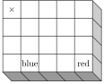

Twenty cubes have been coloured in the following way: There are two red faces opposite each other, two blue faces opposite each other and two green faces opposite each other. The cubes have been glued together as shown in the figure. Two faces that are glued together always have the same colour. The figure shows the colours of some of the faces.

Which colours are possible for the face marked with the symbol $\times$?
