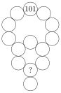

In the figure a number has to be written in each circle. The number 101 is already written in the topmost circle. The sum of the number in a circle and the numbers in its neighbouring circles is called the circle's *Mohr-sum*. Georg writes a number in each circle so they all have the same Mohr-sum.

Is it possible to determine which number Georg writes in the circle marked with a question mark?
