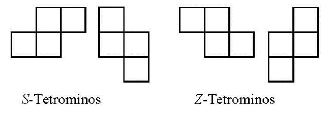

Construct a tetromino by attaching two $2 \times 1$ dominoes along their longer sides such that the midpoint of the longer side of one domino is a corner of the other domino. This construction yields two kinds of tetrominoes with opposite orientations. Let us call them Sand Z-tetrominoes, respectively.  Assume that a lattice polygon $P$ can be tiled with S-tetrominoes. Prove than no matter how we tile $P$ using only S - and Z -tetrominoes, we always use an even number of Z -tetrominoes. (Hungary)

<!-- S5 -->
Aus zwei 2x1-Dominosteinen kann man ein Tetromino konstruieren, indem man die beiden Dominosteine längs ihrer längeren Seiten so aneinanderlegt, dass der Mittelpunkt der längeren Seite des einen Dominosteins ein Eckpunkt des anderen Dominosteins ist. Dabei ergeben sich zwei hinsichtlich ihrer Orientierung verschiedene Typen von Tetrominos, die wir als $S$- bzw. $Z$-Tetromino bezeichnen wollen.

Ein Gitterpunktpolygon $P$ ist eine einfach zusammenhängende Fläche, deren Randlinien nur auf Gitterlinien des ebenen ganzzahligen Koordinatengitters liegen. Eine Pflasterung von $P$ ist eine vollständige und überlappungsfreie Überdeckung von $P$ mit Flächenstücken, die auch nicht teilweise außerhalb von $P$ liegen.

Wir nehmen nun an, dass ein Gitterpunktpolygon $P$ nur mit $S$-Tetrominos gepflastert werden kann. Man beweise: Wenn auch eine Pflasterung von $P$ mit $S$- und $Z$-Tetrominos möglich ist, dann ist die Anzahl der dabei verwendeten $Z$-Tetrominos stets gerade.
