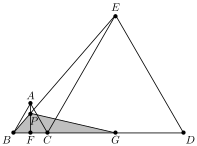

Na figura, os triângulos $ABC$ e $CDE$ são equiláteros, de lados 1 e 4, respetivamente. Além disso, $B$, $C$ e $D$ são colineares e $F$ e $G$ são os pontos médios de $BC$ e $CD$, respetivamente. Seja $P$ o ponto de interseção de $AF$ com $BE$. Determine a área do triângulo sombreado $BPG$.

