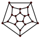

A Lalo le regalaron una red mágica, como la que se muestra en la figura. La red consta de 20 vértices unidos por algunas aristas. Lalo coloca, de una en una, hormigas en los vértices de la red. Las hormigas caminan sobre las aristas, y al hacerlo, la arista recorrida va desapareciendo. Lalo tiene $n$ hormigas y juega colocándolas de la siguiente manera:

1. Coloca una hormiga sobre un vértice y ésta camina libremente hasta que Lalo decide retirarla al llegar a algún vértice. Después, coloca la siguiente hormiga.
2. Cada hormiga recorre al menos una arista.
3. No hay tres hormigas que recorran la misma cantidad de aristas de la red mágica.

Lalo usó cada una de sus hormigas exactamente una vez, y al terminar, la red mágica había desaparecido completamente. ¿Cuál es el mayor número de aristas que pudo haber recorrido una hormiga de Lalo?

