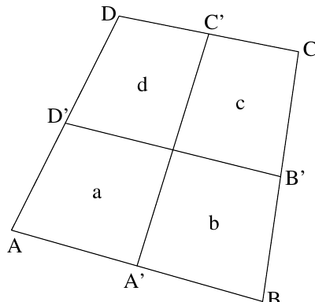

a) Let $ABCD$ be a convex quadrilateral. (Ie. the angles are all less than $180^\circ$.) Let $A'$ be the midpoint of $AB$, $B'$ the midpoint of $BC$, $C'$ the midpoint of $CD$, and $D'$ the midpoint of $AD$. Draw the lines $A'C'$ and $B'D'$, and let $a, b, c$, and $d$ be the areas of the four minor quadrilaterals, as shown in the figure. Prove that $a + c = b + d$.

b) Given a triangle with sides of length $a, b$, and $c$, prove that
$$\frac{a}{b + c} + \frac{b}{a + c} + \frac{c}{a + b} < 2.$$
