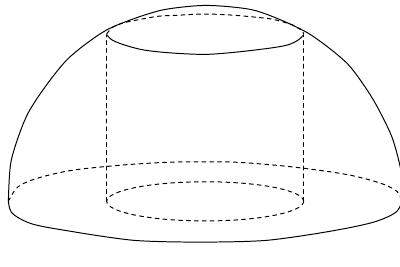
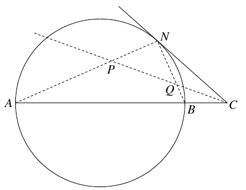

a) We have one half of a ball of radius $3$. Inside this is a cylinder of radius $\sqrt3$ placed in the middle of the bottom plane and which touches the surface of the ball. There is an other such cylinder with a different radius that has the same volume. What radius does this have?

b) Let $AB$ be the diameter of a circle, and let $C$ be a point on the prolongation of $AB$. Draw a line through $C$ which touches the circle in the point $N$. The bisector of the angle $\angle ACN$ intersects the lines $AN$ and $BN$ in the points $P$ and $Q$. Prove that $PN = QN$.

