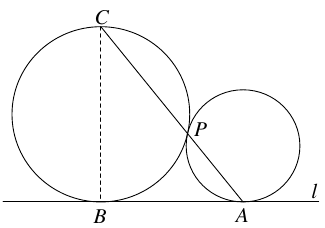
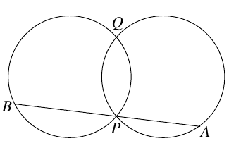

a) Two circles touch a line $l$ in the points $A$ and $B$, and each other in a point $P$. The line $AP$ intersects the other circle in $C$. Prove that $BC$ is normal to $l$.

b) Two circles with the same radii intersect in two different points: $P$ and $Q$. Draw a line through $P$ which is not tangential to any of the circles. In addition to $P$, this line intersects the circles in points $A$ and $B$. Prove that the perpendicular bisector of $AB$ passes through $Q$.

