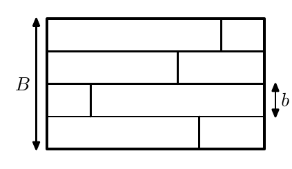

(a) We wish to lay down boards on a floor with width $B$ in the direction across the boards. We have $n$ boards of width $b$, and $B/b$ is an integer, and $nb \le B$. There are enough boards to cover the floor, but the boards may have different lengths. Show that we can cut the boards in such a way that every board length on the floor has at most one join where two boards meet end to end.

(b) $A$ and $B$ play a game on a square board consisting of $n \times n$ white tiles, where $n \ge 2$. $A$ moves first, and the players alternate taking turns. A move consists of picking a square consisting of $2 \times 2$ or $3 \times 3$ white tiles and colouring all these tiles black. The first player who cannot find any such squares has lost. Show that $A$ can always win the game if $A$ plays the game right.
