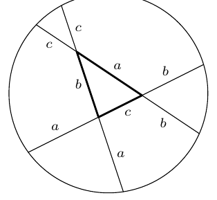

(a) In the triangle $ABC$ the edge $BC$ has length $a$, the edge $AC$ length $b$, and the edge $AB$ length $c$. Extend all the edges at both ends, by the length $a$ from the vertex $A$, $b$ from $B$, and $c$ from $C$. Show that the six endpoints of the extended edges all lie on a common circle.

(b) Show for any positive integer $n$ that there exists a circle in the plane such that there are exactly $n$ grid points within the circle. (A grid point is a point having integer coordinates.)
