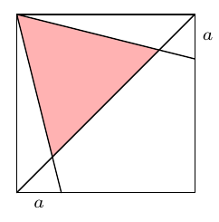

(a) The point $P$ lies on the edge $AB$ of a quadrilateral $ABCD$. The angles $BAD$, $ABC$ and $CPD$ are right, and $AB = BC + AD$. Show that $BC = BP$ or $AD = BP$.

(b) The edges of the square in the figure have length $1$. Find the area of the marked region in terms of $a$, where $0 \le a \le 1$.

