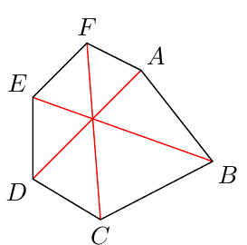

(a) In the quadrilateral $ABCD$ the side $AB$ has length $7$, $BC$ length $14$, $CD$ length $26$, and $DA$ length $23$. Show that the diagonals are perpendicular. You may assume that the quadrilateral is convex (all internal angles are less than $180^\circ$).

(b) The diagonals $AD$, $BE$, and $CF$ of a convex hexagon $ABCDEF$ intersect in a common point. Show that $a(ABE)\,a(CDA)\,a(EFC) = a(BCE)\,a(DEA)\,a(FAC)$, where $a(KLM)$ is the area of the triangle $KLM$.

