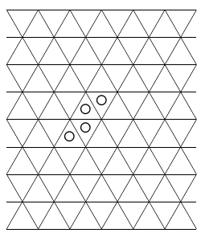

(a) Nils has a telephone number with eight different digits. He has made $28$ cards with statements of the type "The digit $a$ occurs earlier than the digit $b$ in my telephone number", one for each pair of digits appearing in his number.

How many cards can Nils show you without revealing his number?

(b) In an infinite grid of regular triangles, Niels and Henrik are playing a game they made up. Every other time, Niels picks a triangle and writes $\times$ in it, and every other time, Henrik picks a triangle where he writes a $\circ$. If one of the players gets four in a row in some direction (see figure), he wins the game.

Determine whether one of the players can force a victory, or if both players can stop the other from winning.
