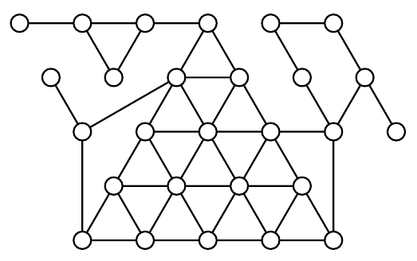

(a) In how many ways can the circles be coloured using three colours, so that no two circles connected by a line segment have the same colour?

(b) A round table has room for $n$ diners ($n \ge 2$). There are napkins in three different colours. In how many ways can the napkins be placed, one for each seat, so that no two neighbours get napkins of the same colour?
