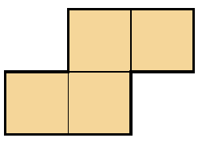

Nils has an $M \times N$ board where $M$ and $N$ are positive integers, and a tile shaped as shown below. What is the smallest number of squares that Nils must colour, so that it is impossible to place the tile on the board without covering a coloured square? The tile can be freely rotated and mirrored, but it must completely cover four squares.

